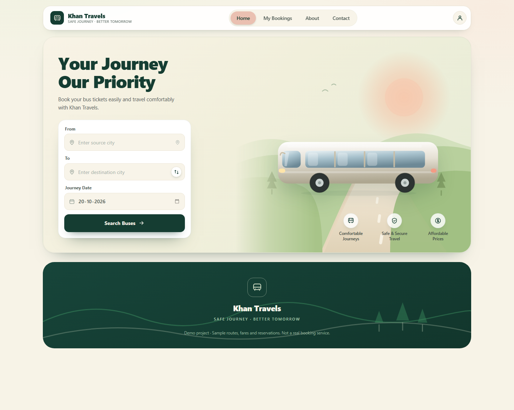
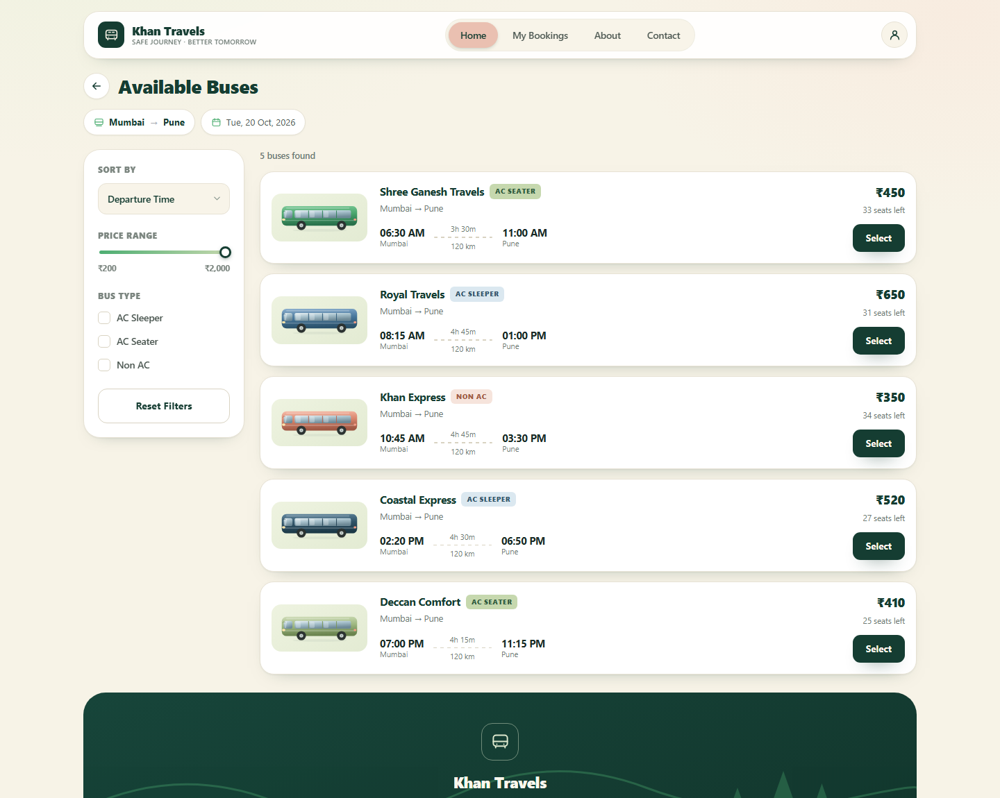
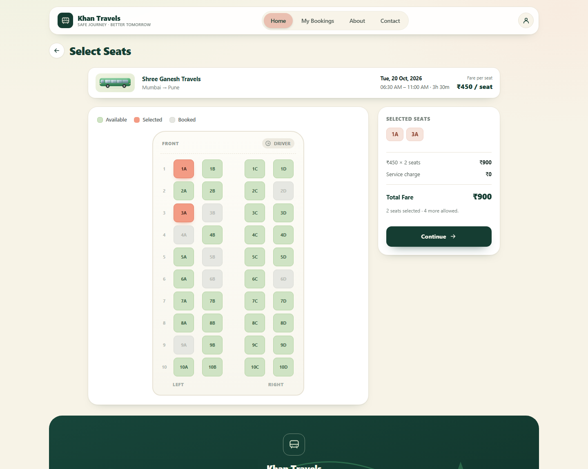

# Khan Travels — Bus Reservation

**Safe Journey · Better Tomorrow**

### ▶ [Open the live demo →](https://khan-travels.vercel.app)

**https://khan-travels.vercel.app** — deployed from this repository on Vercel, no install needed.

A premium bus reservation website built with plain **HTML, CSS and vanilla JavaScript**. No frameworks, no build step, no backend, no database. Bookings persist in the browser's `localStorage`.



## Run it locally

Three ways, none of which need an install:

**1. Just open it.** Double-click `index.html`. The whole site works from `file://` — search, seat selection, booking, printing.

**2. Serve it** (recommended; behaves exactly like the deployed site):

```bash
# Python 3 (already on most machines)
python -m http.server 8000
# then open http://localhost:8000
```

```bash
# or Node
npx serve .
```

**3. Open the live demo:** [khan-travels.vercel.app](https://khan-travels.vercel.app) — the deployed build, running exactly these committed files.

## Deploy

The repo is laid out for static hosting — `index.html` sits at the root and every asset path is relative, so it works at a domain root *or* under a subpath.

**Vercel (currently live).** The project is linked to this repository, so every push to `main` ships to production automatically. To deploy by hand:

```bash
npx vercel@latest deploy --prod --yes --project khan-travels
```

No build command and no output directory are needed — Vercel serves the repository root. `.vercelignore` keeps the local verification screenshots out of the upload.

**GitHub Pages (optional fallback):** nothing is published there today, so do not link to a Pages URL until you enable it. Settings → Pages → Source: *Deploy from a branch* → Branch: `main`, folder: `/ (root)` → Save, and it will serve from a minute or two later. The `.nojekyll` file is already present for this.

**Netlify / Cloudflare Pages:** point them at this repo and leave the build command empty, publishing the repository root. There is nothing to compile.

## Screens





The app is a single page with eight views switched by JavaScript — no reloads, no router:

| View | What it does |
| --- | --- |
| Home | Split hero, search form with route swap, three benefit highlights |
| Available Buses | Filter sidebar (sort, price, AC/Non-AC), 5 operators, empty states |
| Select Seats | Interactive CSS Grid seat map, live total, 6-seat cap |
| Passenger Details | One form per selected seat, inline validation |
| Confirmation | Booking reference, full trip summary, print ticket |
| My Bookings | History with cancel-and-release |
| About / Contact | Brand story and a contact form |

## Features

- **Real search** — rejects empty, identical and past-date journeys, then filters the timetable by route and date.
- **Filters that compose** — sort by departure/price/duration, price slider, AC Sleeper / AC Seater / Non AC, with an inline reset that restores all results.
- **Seats as buttons** — booked seats are `disabled`, selecting toggles a coral highlight, the summary and total recompute instantly, and a seventh click is refused with a toast.
- **Persistent bookings** — transactions are written to `localStorage`, so a refresh keeps your history and reserved seats show as booked for that bus and date.
- **Cancellation releases seats** — the seat becomes available again while the record stays in history, marked Cancelled.
- **Printable ticket** — a dedicated 12-row layout printed via `@media print`, with the site chrome hidden.
- **Survives bad data** — corrupt JSON, an object where an array belongs, and junk entries all degrade to an empty state instead of throwing.
- **Escaped output** — every user-supplied value passes through `escapeHtml()` before it reaches `innerHTML`, including the printed ticket.

## Tech

| | |
| --- | --- |
| Markup | Semantic HTML5, labelled form controls, `aria-live` toasts |
| Styling | CSS custom properties, Grid, Flexbox, `clamp()`, media queries |
| Logic | Vanilla ES5-compatible JavaScript in one IIFE — no globals leaked |
| Artwork | Hand-built inline SVG coaches and scenery in `assets/` — no image CDN, no external requests |
| Storage | `localStorage` only |

## Structure

```
index.html        All eight views
styles.css        Design system + layout + print styles
app.js            State, rendering, validation, booking logic
assets/           Six SVG coach illustrations
preview/          Screenshots used above
.nojekyll         Keeps GitHub Pages from running Jekyll
```

## Limitations

This is a front-end demo, and it is honest about it:

- **No backend.** There is no shared inventory — two browsers can book the same seat.
- **No real payments.** The final action is "Confirm Booking"; no card is charged and no payment step is simulated.
- **`localStorage` is not secure storage** and does not sync across devices. Clearing browser data erases all bookings.
- **Sample data.** Five operators with fixed timetables, defined in `app.js`.

## License

MIT — use it, fork it, rename it.
